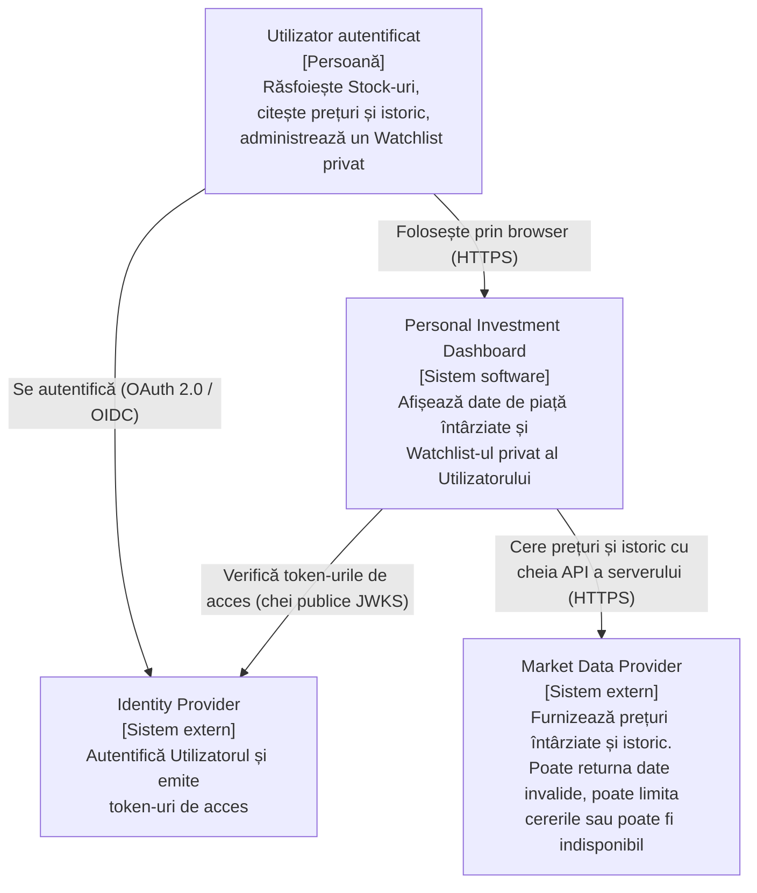
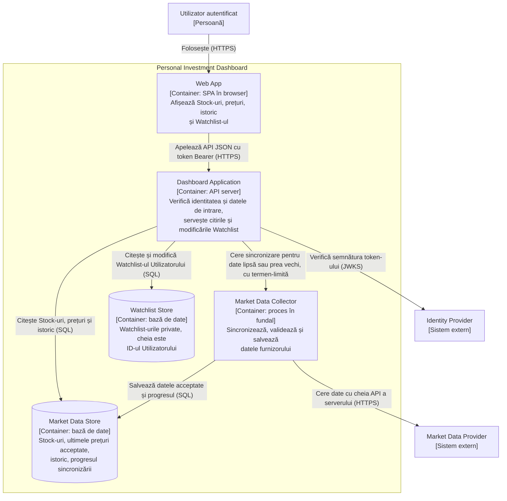
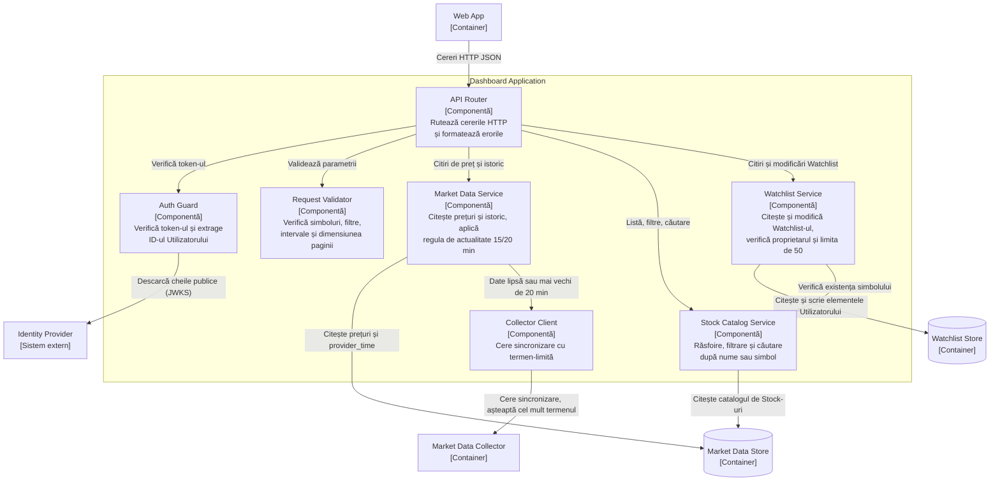
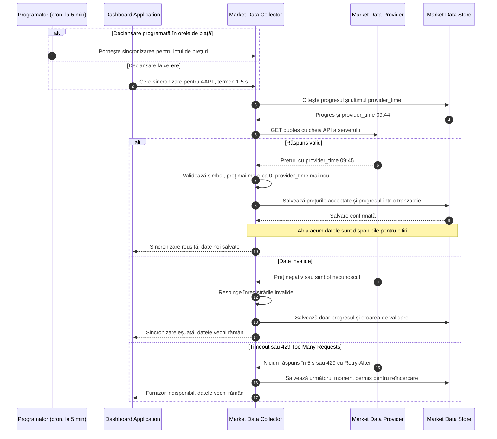
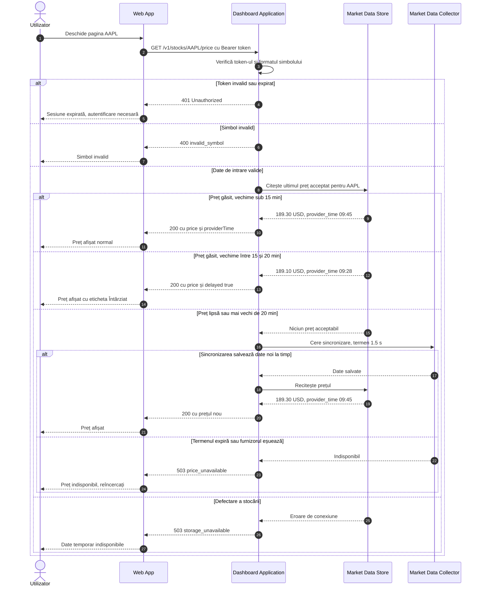
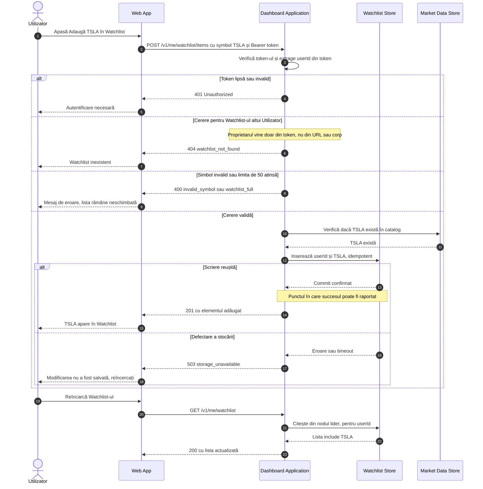

# Lab 3: Limita Dashboard-ului — arhitectura de bază

Acest laborator descrie arhitectura de bază a **Personal Investment Dashboard** prin trei view-uri C4 (System Context, Container, Component) și verifică proiectarea cu trei diagrame de secvență.

**Date preluate din laboratoarele anterioare:**

* Utilizatorul autentificat răsfoiește și filtrează Stock-uri, citește prețuri și istoric și administrează un Watchlist privat (maximum 50 de Stock-uri, Lab 1, DASH-1).
* Furnizorul de date de piață are o întârziere de 15 minute. Vechimea maximă acceptată a unui preț este de **20 de minute** (15 minute întârziere + 5 minute toleranță internă). Între 15 și 20 de minute prețul este marcat „întârziat”, iar peste 20 de minute rezultatul este „indisponibil” (Lab 2).
* Latența citirilor: p95 ≤ 2 secunde. La depășirea termenului, serverul returnează rapid `503` (Lab 2).
* Watchlist: consistență „Read-Your-Writes” pentru același Utilizator (Lab 2).
* Volum (3,000 Utilizatori): 792 RPS în regim stabil și 987 RPS la deschiderea pieței; 600 RPS sunt citiri de preț (Lab 2).

**Decizie nouă față de Lab 1:** citirile Utilizatorilor **nu** mai solicită direct furnizorul. Datele de piață sunt aduse de un **Market Data Collector** separat, care validează și salvează datele acceptate, iar Dashboard-ul citește doar datele stocate (exemplul din Lecția 4).

---

## 1. Diagrama System Context

Limita sistemului conține tot ce operăm noi. Utilizatorul se autentifică la Identity Provider, iar Dashboard-ul verifică doar token-ul primit. Cheia API a furnizorului nu ajunge niciodată în browser.

---

## 2. Diagrama Container

| Container | Responsabilitate |
| :--- | :--- |
| **Web App** | Interfața din browser. Nu păstrează date de piață sau credențiale ale furnizorului. |
| **Dashboard Application** | Singurul punct de intrare pentru Utilizator: verifică token-ul, validează datele de intrare, citește datele acceptate și aplică regulile de actualitate (15/20 min). |
| **Market Data Collector** | Singurul container care vorbește cu furnizorul. Validează înregistrările înainte de salvare și limitează cererile la cota furnizorului. |
| **Market Data Store** | Sursa durabilă pentru datele de piață acceptate și momentele furnizorului (`provider_time`). |
| **Watchlist Store** | Sursa durabilă pentru datele private ale Utilizatorilor. Este separat de datele de piață, deoarece are alt model de acces (scrieri ale Utilizatorilor, Read-Your-Writes). |

Acesta este cel mai mic set de containere care separă citirile Utilizatorilor de sincronizarea cu furnizorul. Cache-ul și replicile sunt adăugate abia în Laboratorul 4.

---

## 3. Diagrama Component — Dashboard Application

Toate componentele aparțin aceluiași proces Dashboard Application. Ele nu sunt servicii separate.

---

## 4. Diagrame de secvență

Participanții folosesc aceleași nume ca în view-urile de arhitectură. Market Data Collector este desenat ca un singur participant; detaliile lui interne urmează exemplul din Lecția 4.

### A. Sincronizează datele de piață

**Ipoteze inițiale:**

* Sincronizarea programată rulează la fiecare 5 minute în orele de piață, iar sincronizarea la cerere este folosită doar pentru date lipsă sau mai vechi de 20 de minute.
* Cheia API a furnizorului se află doar în Market Data Collector, pe server.
* O singură sincronizare activă pentru fiecare cheie (furnizor, set de date, lot); cererile pentru aceeași cheie se alătură sincronizării existente.
* **La eșec, datele acceptate anterior nu sunt șterse și nu sunt suprascrise.** Ele rămân disponibile, iar Dashboard-ul le marchează ca „întârziate” sau „indisponibile” după vârsta lor.

### B. Citește prețul unui Stock

**Ipoteze inițiale:**

* **O citire obișnuită a Utilizatorului nu face o cerere nouă către furnizor.** Dashboard-ul citește datele acceptate din Market Data Store. Doar un preț lipsă sau mai vechi de 20 de minute declanșează o cerere de sincronizare către Collector, nu direct către furnizor.
* Termenul de 1.5 secunde pentru sincronizare păstrează ținta p95 ≤ 2 s.
* O defectare a stocării nu este tratată ca un preț lipsă: răspunsul este `503`, fără a încerca furnizorul.

### C. Modifică un Watchlist privat

**Ipoteze inițiale:**

* ID-ul proprietarului este luat **doar** din token. O încercare de a accesa Watchlist-ul altui Utilizator primește `404`, ca să nu dezvăluie existența lui.
* Succesul se raportează numai după confirmarea commit-ului în Watchlist Store.
* **Următoarea citire a aceluiași Utilizator trebuie să arate TSLA** (Read-Your-Writes, Lab 2). Citirile Watchlist folosesc nodul lider, nu o replică întârziată.
* Dacă scrierea eșuează, Watchlist-ul rămâne neschimbat și Utilizatorul vede că modificarea nu a fost salvată.

---

## Listă de verificare

- [x] Am inclus o diagramă System Context, una Container și una Component.
- [x] Am inclus cele trei diagrame de secvență cerute.
- [x] Toate cele șase blocuri Mermaid se afișează fără erori.
- [x] Diagrama Component deschide numai Dashboard Application.
- [x] Fluxurile mele arată rezultate normale, acțiuni respinse și rezultate în caz de defectare.
- [x] Proiectarea acoperă citirile normale, datele private, preluarea datelor de la furnizor și defectările.
