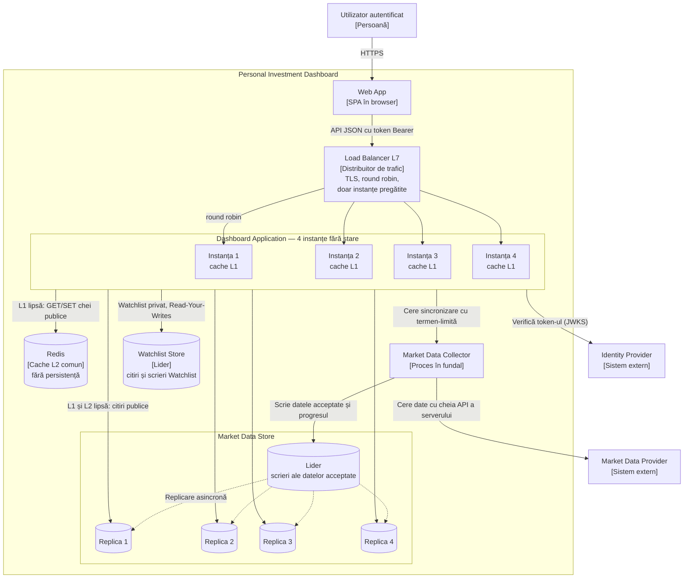
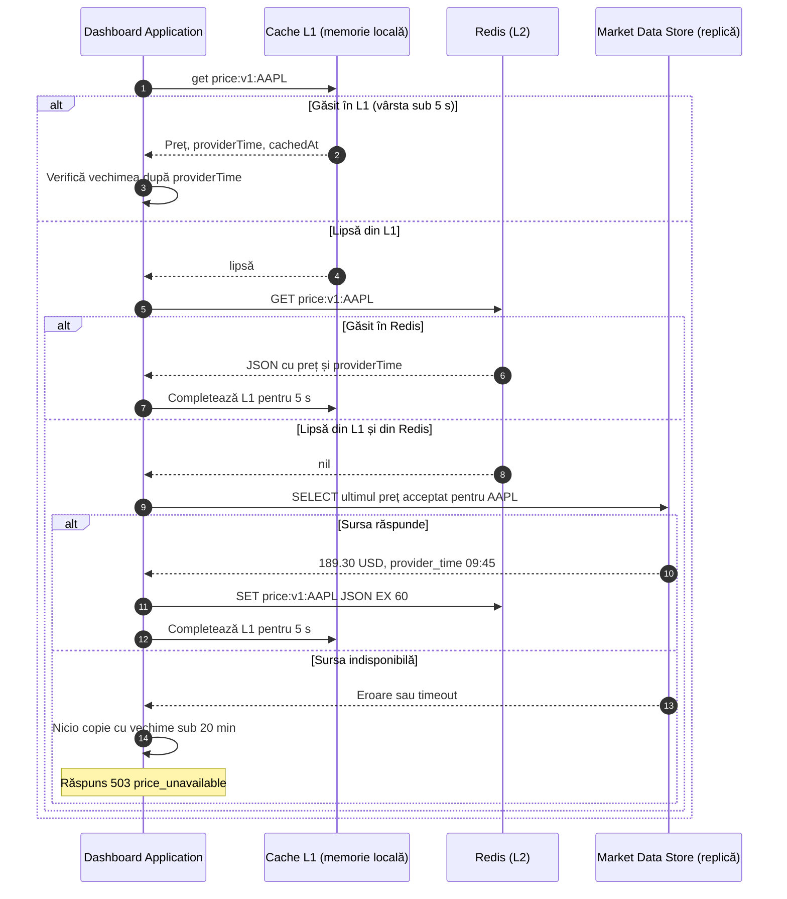
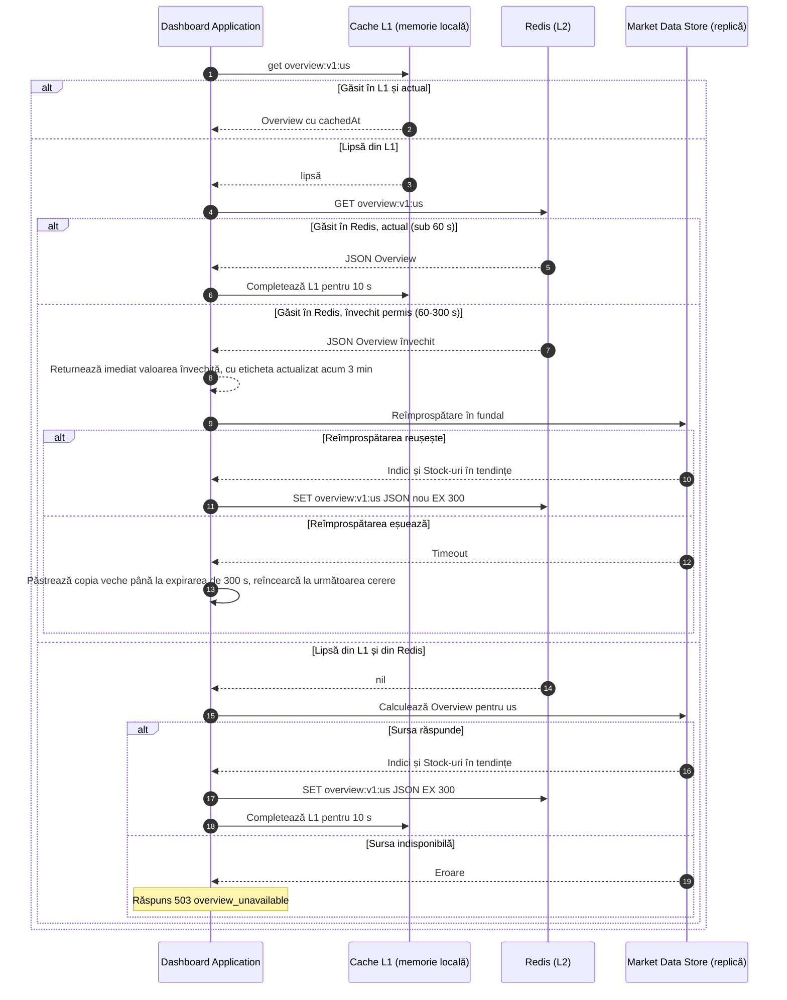
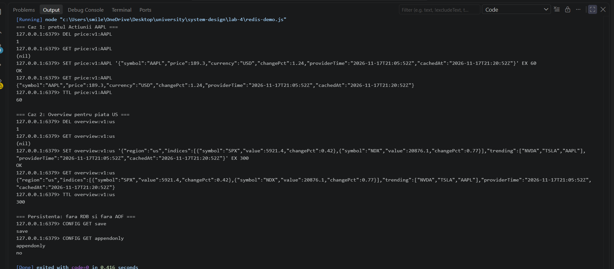

# Lab 4: Scalarea traseului de citire al Dashboard-ului

Acest laborator aplică Lecția 5 la **Personal Investment Dashboard**: scalăm Dashboard Application și Market Data Store, alegem distribuirea traficului și proiectăm două cazuri de cache cu memorie locală (L1) și Redis (L2).

**Decizii păstrate din laboratoarele anterioare:**

* Latență p95 ≤ 2 s; vechimea maximă a unui preț este 20 de minute (15 minute întârziere a furnizorului + 5 minute toleranță). Între 15 și 20 de minute prețul este marcat „întârziat”, peste 20 de minute este „indisponibil” (Lab 2).
* Watchlist: Read-Your-Writes pentru același Utilizator (Lab 2).
* Limita sistemului și containerele din Lab 3: Web App, Dashboard Application, Market Data Collector, Market Data Store, Watchlist Store. Citirile Utilizatorilor nu apelează direct furnizorul.

**Schimbări față de Lab 3:** adăugăm un distribuitor de trafic, mai multe instanțe Dashboard, replici de citire pentru Market Data Store și Redis ca nivel comun de cache. Watchlist Store rămâne pe un singur lider (30 RPS, Lab 2), pentru Read-Your-Writes.

---

## 1. Scalarea serviciului și rutarea cererilor

### 1.1 Numărul de instanțe Dashboard

| Pas | Calcul | Rezultat |
| :--- | :--- | :--- |
| Ținta pentru prețuri, cu marjă de 20% | `600 RPS x 1.20` | **720 RPS** |
| Instanțe necesare pentru țintă | `ceil(720 / 250)` | 3 instanțe (3 x 250 = 750 RPS ≥ 720) |
| Toleranță la pierderea unei instanțe (N+1) | `3 + 1` | **4 instanțe pregătite** |
| Verificare după oprirea unei instanțe | `(4 - 1) x 250` | 750 RPS ≥ 720 RPS ✔ |

Cu 3 instanțe, pierderea uneia ar lăsa doar `2 x 250 = 500 RPS < 720 RPS`, deci minimul sigur este **4 instanțe**. Valorile se potrivesc cu exemplul HPA din Lecția 5 (`requests: cpu 500m, memory 512Mi`, `minReplicas: 4`). Nu presupunem nicio rată de găsire în cache: cele 4 instanțe susțin ținta chiar și cu cache-ul gol.

### 1.2 Distribuirea traficului: L7, round robin

* **Alegere:** Load balancer **L7 (HTTP)**, de exemplu un Ingress, cu metoda **round robin** între instanțele pregătite (readiness probe).
* **De ce L7:** terminăm TLS o singură dată, putem ruta după cale (`/v1/stocks/...`, `/v1/me/watchlist`), putem returna `503` rapid și scoatem din rotație instanțele care nu trec verificarea readiness.
* **De ce round robin:** cererile pentru prețuri au costuri de procesare similare și sunt scurte, iar instanțele sunt fără stare (sesiunea este token-ul Bearer). Nu folosim hash după IP-ul clientului: Utilizatorii din spatele aceluiași NAT ar ajunge toți pe o singură instanță, iar la pierderea ei echilibrul s-ar strica.
* **Limita principală:** round robin nu vede încărcarea reală. O instanță încetinită (GC, vecin zgomotos, cereri History mai lungi) primește în continuare aceeași cotă de cereri. Dacă măsurătorile arată costuri inegale, trecem la **least connections**.

### 1.3 Starea după pierderea unei instanțe Dashboard

| Trebuie să se păstreze (stocare durabilă, în afara instanței) | Poate rămâne doar în memoria instanței (se poate pierde) |
| :--- | :--- |
| Watchlist-urile Utilizatorilor (Watchlist Store) | Cache-ul L1 (prețuri, Overview) |
| Prețurile acceptate, `provider_time`, istoricul (Market Data Store) | Pool-urile de conexiuni către baze de date și Redis |
| Progresul sincronizării cu furnizorul (Market Data Store) | Cheile publice JWKS descărcate de la Identity Provider |
| Identitatea Utilizatorului (token-ul emis de Identity Provider, păstrat de client) | Cererile în curs; clientul le reîncearcă pe altă instanță |

Instanțele nu păstrează sesiuni locale, deci oricare dintre ele poate servi orice cerere.

---

## 2. Scalarea Market Data Store

Citirile publice (fără date private) folosesc replicile; liderul este rezervat pentru scrierile Collector-ului și pentru citirile care au nevoie de cea mai recentă valoare a sa.

| Citire publică (Lab 2, 3,000 Utilizatori) | RPS | Cu marjă 20% |
| :--- | :--- | :--- |
| Prețul unui Stock | 600 | 720 |
| Overview + Filter + History + Search | 70 + 75 + 2 + 15 = 162 | 194.4 |
| **Total citiri publice** | **762** | **914.4** |

* Replici necesare: `ceil(914.4 / 400) = 3` replici (1,200 RPS).
* Toleranță la pierderea unei replici: **4 replici de citire** (după pierderea uneia: `3 x 400 = 1,200 RPS ≥ 914.4`).
* Liderul nu este inclus în capacitatea de citire publică. Watchlist-ul (30 RPS) folosește Watchlist Store, nu Market Data Store.

### Container View actualizat



Datele private (Watchlist) nu trec prin Redis și nu sunt citite din replici.

---

## 3. Cache pentru două citiri publice

### Cazul 1: Prețul unui Stock

**Munca repetată eliminată:** la 720 RPS, mii de Utilizatori cer aceleași câteva sute de simboluri populare, iar prețul acceptat se schimbă doar la o sincronizare (cel mult o dată la 5 minute). Fără cache, fiecare citire face o interogare la o replică.

| Decizie | Contract |
| :--- | :--- |
| **Cheie și valoare** | Cheie: `price:v1:{SYMBOL}` (ex. `price:v1:AAPL`). Singura intrare care schimbă rezultatul este simbolul. Valoare JSON: `symbol`, `price`, `currency`, `changePct`, `providerTime`, `cachedAt`. Nu conține date ale Utilizatorului. |
| **Sursă** | Market Data Store, tabelul cu ultimele prețuri acceptate (`latest_prices`), citit dintr-o replică. |
| **Durată de viață L1** | 5 secunde în memoria fiecărei instanțe. |
| **Actualitate** | **TTL simplu.** Redis `EX 60` secunde. Actualitatea se decide după `providerTime`, nu după TTL: vechime ≤ 15 min → actual; 15–20 min → „întârziat”; > 20 min → valoarea nu se returnează (Lab 2). |
| **Rezultat la defectare** | L1 lipsă/pierdut → Redis. Redis gol sau indisponibil → replică (cu limită de concurență). Replică indisponibilă → dacă există o copie în L1/Redis cu vechime ≤ 20 min, se returnează marcată „întârziat”; altfel `503 price_unavailable`. |



### Cazul 2: Overview-ul pieței

**Munca repetată eliminată:** Overview-ul (cardurile indicilor regionali și lista de Stock-uri în tendințe, Lab 1) este identic pentru toți Utilizatorii unei regiuni, dar costă mai multe interogări (indici, sortare după `changePct`). La deschiderea pieței este cerut de 130 RPS (Lab 2).

| Decizie | Contract |
| :--- | :--- |
| **Cheie și valoare** | Cheie: `overview:v1:{region}` (ex. `overview:v1:us`). Intrarea care schimbă rezultatul: regiunea. Valoare JSON: `region`, `indices[]`, `trending[]`, `providerTime`, `cachedAt`. Fără Watchlist sau alte date private. |
| **Sursă** | Market Data Store: indicii și ultimele prețuri acceptate, calculate dintr-o replică. |
| **Durată de viață L1** | 10 secunde. |
| **Actualitate** | **Stale-while-revalidate.** Actual dacă `now - cachedAt ≤ 60 s`; învechit permis dacă `60 s < now - cachedAt ≤ 300 s` (se returnează imediat și se pornește o reîmprospătare în fundal); expirat după 300 s (Redis `EX 300`). Nicio valoare cu `providerTime` mai vechi de 20 min nu este afișată ca actuală. |
| **Rezultat la defectare** | Redis indisponibil → replică. Replică indisponibilă → copie învechită permisă cu eticheta „actualizat acum X min”, altfel `503 overview_unavailable` și cardurile afișează „Tendință indisponibilă” (Lab 1, DASH-3). |



### Încărcarea în avans (pre-warm) și accesul de rezervă la sursă

* **Ce încărcăm în avans:** la 09:20 (cu 10 minute înainte de deschiderea pieței) și după recuperarea Redis, încărcăm doar un set limitat de chei: `overview:v1:{region}` pentru toate regiunile (sub 10 chei) și `price:v1:{SYMBOL}` pentru **cele mai urmărite 500 de simboluri** (cele mai frecvente în Watchlist-uri), din cele 5,613 Stock-uri (Lab 2).
* **Limita încărcării:** cel mult 100 de chei pe secundă dintr-o singură instanță coordonatoare, deci 500 de prețuri se încarcă în aproximativ 5 secunde, fără să suprasolicite replicile.
* **Acces de rezervă la sursă:** fiecare instanță poate trimite către replici cel mult 230 de citiri pe secundă la ratare în cache (4 x 230 = 920 ≈ capacitatea calculată de 914 RPS). Cererile concurente pentru aceeași cheie se unesc într-o singură citire a sursei.
* **Ce vede Utilizatorul când încărcarea este incompletă:** prima cerere pentru un simbol neîncărcat merge la replică (puțin mai lent, dar în ținta de 2 s).
* **Ce vede Utilizatorul când capacitatea de rezervă este epuizată:** dacă există o copie cu vechime ≤ 20 min, o primește marcată „întârziat”; altfel primește `503` cu `Retry-After: 5`, iar UI-ul afișează „Preț temporar indisponibil, reîncercăm automat”.

---

## 4. Traseul cache-ului Redis prin comenzi

Comenzile au fost rulate pe un server Redis local (Redis 5.0.14 pentru Windows, `127.0.0.1:6379`), pornit fără persistență pe disc. Conexiunea a fost verificată cu `redis-cli PING` → `PONG`. Scriptul [`redis-demo.js`](./redis-demo.js) rulează comenzile `redis-cli` în ordinea cerută; a fost executat în VS Code.

**Captură (rularea în VS Code):**



### Cazul 1: prețul Stock-ului AAPL

```text
127.0.0.1:6379> GET price:v1:AAPL
(nil)
127.0.0.1:6379> SET price:v1:AAPL '{"symbol":"AAPL","price":189.3,"currency":"USD","changePct":1.24,"providerTime":"2026-11-17T21:05:52Z","cachedAt":"2026-11-17T21:20:52Z"}' EX 60
OK
127.0.0.1:6379> GET price:v1:AAPL
{"symbol":"AAPL","price":189.3,"currency":"USD","changePct":1.24,"providerTime":"2026-11-17T21:05:52Z","cachedAt":"2026-11-17T21:20:52Z"}
127.0.0.1:6379> TTL price:v1:AAPL
60
```

Între `GET` (nil) și `SET`, aplicația citește sursa durabilă (Market Data Store), ca în diagrama de secvență a Cazului 1.

### Cazul 2: Overview-ul pieței US

```text
127.0.0.1:6379> GET overview:v1:us
(nil)
127.0.0.1:6379> SET overview:v1:us '{"region":"us","indices":[{"symbol":"SPX","value":5921.4,"changePct":0.42},{"symbol":"NDX","value":20876.1,"changePct":0.77}],"trending":["NVDA","TSLA","AAPL"],"providerTime":"2026-11-17T21:05:52Z","cachedAt":"2026-11-17T21:20:52Z"}' EX 300
OK
127.0.0.1:6379> GET overview:v1:us
{"region":"us","indices":[{"symbol":"SPX","value":5921.4,"changePct":0.42},{"symbol":"NDX","value":20876.1,"changePct":0.77}],"trending":["NVDA","TSLA","AAPL"],"providerTime":"2026-11-17T21:05:52Z","cachedAt":"2026-11-17T21:20:52Z"}
127.0.0.1:6379> TTL overview:v1:us
300
```

### `cachedAt` vs. `providerTime` și de ce TTL nu dovedește actualitatea

* `providerTime` este momentul observației furnizorului (21:05:52), iar `cachedAt` este momentul în care am completat cache-ul (21:20:52). Diferența de 15 minute este întârzierea furnizorului.
* **TTL-ul Redis spune doar cât timp mai păstrăm copia, nu cât de vechi sunt datele.** O valoare cu TTL 60 poate conține un preț observat de furnizor acum 18 minute, deoarece sursa însăși poate fi veche (sincronizare eșuată, furnizor indisponibil). De aceea aplicația verifică întotdeauna `providerTime` față de limitele 15/20 minute, indiferent de TTL.

### Persistența Redis

```text
127.0.0.1:6379> CONFIG GET save
save

127.0.0.1:6379> CONFIG GET appendonly
appendonly
no
```

Redis este folosit **fără persistență pe disc** (fără RDB și fără AOF). Redis este doar o copie: sursa adevărului este Market Data Store. După o repornire, Redis pornește gol; cererile trec prin ratare la replică (în limita accesului de rezervă), iar încărcarea în avans repopulează cele mai urmărite 500 de prețuri și Overview-urile în câteva secunde.

---

## Listă de verificare

- [x] Calculul meu pentru instanțele Dashboard include marja și pierderea unei instanțe.
- [x] Am ales un nivel și o metodă de distribuire a traficului și am explicat motivul și o limită.
- [x] Container View actualizat arată distribuitorul de trafic, instanțele serviciului și instanțele bazei de date. Starea necesară se păstrează după pierderea unei instanțe a serviciului.
- [x] Am cel puțin două cazuri de utilizare a cache-ului, cu un contract și o diagramă de secvență pentru fiecare, care arată L1, Redis și sursa durabilă.
- [x] Cheile și valorile mele din cache nu conțin date private ale Utilizatorilor.
- [x] Secvențele mele arată valori găsite în cache, valori lipsă, defectarea sursei și comportamentul stale-while-revalidate ales.
- [x] Încărcarea mea în avans este limitată, iar încărcarea incompletă sau capacitatea de rezervă epuizată are un rezultat explicit vizibil pentru Utilizator.
- [x] Fiecare transcriere Redis arată o valoare lipsă la `GET`, `SET ... EX`, o valoare găsită la `GET` și `TTL`, cu o valoare JSON și o alegere de persistență.
- [x] Explic de ce TTL-ul Redis nu dovedește actualitatea datelor sursă.
- [x] Diagramele mele Mermaid se randează fără erori.
