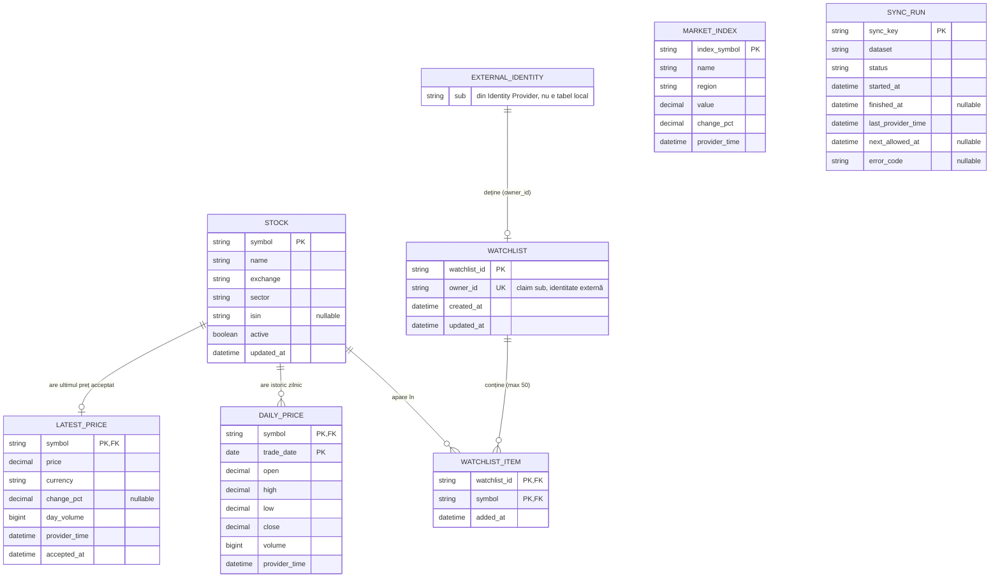

# Lab 5: Modelul datelor și API-ul Dashboard-ului

```text
Data model -> endpoints -> source definitions -> OpenAPI -> client flow
```

**Proiectarea preluată din Lab 1–4:** vechimea maximă a unui preț este 20 de minute (15 minute întârziere a furnizorului + 5 minute toleranță); Watchlist-ul are cel mult 50 de Stock-uri și cere Read-Your-Writes; citirile Utilizatorilor nu apelează furnizorul, ci datele acceptate (cache L1/Redis, apoi replicile Market Data Store); identitatea vine de la un Identity Provider extern.

**Domeniu:** consultarea pieței, Stock-uri în tendințe, filtrare și căutare, detaliile Stock-urilor, ultimele prețuri acceptate și istoricul zilnic, Watchlist-ul privat (citire, adăugare, eliminare). Comenzile, deținerile, P&L, SSE și partajarea publică nu fac parte din acest laborator.

---

## 1. Modelul datelor

### 1.1 Entități

| Entitate | Scop | Identitate | Apartenență |
| :--- | :--- | :--- | :--- |
| **stock** | Catalogul instrumentelor (5,613 acțiuni din SUA, Lab 2) | `symbol` | Date publice de piață |
| **latest_price** | Ultimul preț acceptat pentru fiecare Stock | `symbol` (1:1 cu stock) | Date publice de piață |
| **daily_price** | Istoricul zilnic (OHLCV) | (`symbol`, `trade_date`) | Date publice de piață |
| **market_index** | Indicii regionali pentru Overview (SPX, NDX, DAX etc.) | `index_symbol` | Date publice de piață |
| **watchlist** | Watchlist-ul privat al unui Utilizator | `watchlist_id`; unic după `owner_id` | Privat, aparține Utilizatorului |
| **watchlist_item** | Un Stock din Watchlist | (`watchlist_id`, `symbol`) | Privat, prin watchlist |
| **sync_run** | Înregistrare internă a sincronizării cu furnizorul (Lab 3, Collector) | `sync_key` | Intern, fără endpoint pentru client |

Utilizatorul autentificat este o **identitate externă**: `owner_id` este claim-ul `sub` din token. Nu există un tabel local `user`.

### 1.2 Câmpuri

**stock**

| Câmp (snake_case) | Sens | Exemplu | Valoare lipsă |
| :--- | :--- | :--- | :--- |
| `symbol` | Simbolul bursier, cheie | `AAPL` | Obligatoriu |
| `name` | Numele companiei | `Apple Inc.` | Obligatoriu |
| `exchange` | Bursa | `NASDAQ` | Obligatoriu |
| `sector` | Sectorul | `Technology` | `Unknown` dacă furnizorul nu îl dă |
| `isin` | Cod internațional | `US0378331005` | `null` dacă lipsește |
| `active` | Este încă listat | `true` | Obligatoriu; delistatele rămân cu `false` |
| `updated_at` | Ultima actualizare a datelor de referință | `2026-11-17T06:00:00Z` | Obligatoriu |

**latest_price**

| Câmp | Sens | Exemplu | Valoare lipsă |
| :--- | :--- | :--- | :--- |
| `symbol` | Stock-ul | `AAPL` | Obligatoriu |
| `price` | Ultimul preț acceptat | `189.30` | Rândul lipsește până la prima sincronizare reușită |
| `currency` | Moneda | `USD` | Obligatoriu |
| `change_pct` | Schimbarea față de închiderea anterioară | `1.24` | `null` dacă nu există închidere anterioară |
| `day_volume` | Volumul zilei (pentru ordonarea tendințelor) | `51234000` | `0` dacă furnizorul nu îl dă |
| `provider_time` | Momentul observației furnizorului | `2026-11-17T14:45:00Z` | Obligatoriu (fără el înregistrarea este respinsă) |
| `accepted_at` | Momentul salvării după validare | `2026-11-17T14:46:03Z` | Obligatoriu |

**daily_price**: `symbol`, `trade_date` (`2026-11-14`), `open`, `high`, `low`, `close`, `volume`, `provider_time`. O zi lipsă (sărbătoare, eroare) nu are rând; nu completăm cu zero.

**market_index**: `index_symbol` (`SPX`), `name` (`S&P 500`), `region` (`us`), `value` (`5921.4`), `change_pct` (`0.42`), `provider_time`.

**watchlist**: `watchlist_id` (`wl_7f3a`), `owner_id` (`auth0|64f1c2`), `created_at`, `updated_at`. Se creează la prima adăugare; lipsa lui înseamnă Watchlist gol.

**watchlist_item**: `watchlist_id`, `symbol` (`TSLA`), `added_at` (`2026-11-17T15:02:11Z`). Toate obligatorii.

**sync_run**: `sync_key` (`quotes:batch-07`), `dataset` (`latest_price`), `status` (`succeeded`, `failed`, `running`), `started_at`, `finished_at` (`null` cât rulează), `last_provider_time`, `next_allowed_at` (după `429`), `error_code` (`null` la succes).

### 1.3 Diagrama ER



Datele de piață (STOCK, LATEST_PRICE, DAILY_PRICE, MARKET_INDEX, SYNC_RUN) stau în Market Data Store; WATCHLIST și WATCHLIST_ITEM stau în Watchlist Store (Lab 3).

### 1.4 Valori stocate vs. derivate

| Valoare derivată (API, camelCase) | Calcul | Nu se stochează pentru că |
| :--- | :--- | :--- |
| `freshness` | `fresh` dacă `now - provider_time ≤ 15 min`; `delayed` între 15 și 20 min; peste 20 min prețul nu se returnează (`latestPrice: null` sau `503`) | Depinde de momentul citirii |
| `itemCount` | Numărul de `watchlist_item` ale Watchlist-ului | Se poate desincroniza de rânduri |
| `asOf` (tendințe) | Cel mai vechi `provider_time` din listă | Depinde de lista returnată |

**Ordonarea Stock-urilor în tendințe:** doar Stock-uri `active` cu preț `fresh` sau `delayed`, ordonate după `change_pct` descrescător, apoi `day_volume` descrescător, apoi `symbol` crescător (ordine stabilă).

---

## 2. Endpoint-urile clientului

| Acțiunea produsului | Metodă și cale cu versiune | Parametri sau corp | Succes | Regulă de acces |
| :--- | :--- | :--- | :--- | :--- |
| Consultarea generală a pieței | `GET /v1/market/overview` | `region` (`us` implicit) | `200` Overview | Bearer |
| Stock-uri în tendințe | `GET /v1/stocks/trending` | `limit` (1–50, implicit 10) | `200` listă | Bearer |
| Filtrare și căutare după nume sau simbol | `GET /v1/stocks` | `q`, `sector`, `exchange`, `minPrice`, `maxPrice`, `sort`, `limit`, `cursor` | `200` pagină | Bearer |
| Detaliile unui Stock | `GET /v1/stocks/{symbol}` | `symbol` | `200` detalii | Bearer |
| Cel mai recent preț acceptat | `GET /v1/stocks/{symbol}/price` | `symbol` | `200` preț | Bearer |
| Istoricul zilnic | `GET /v1/stocks/{symbol}/history` | `from`, `to` (obligatorii, max 366 zile) | `200` istoric | Bearer |
| Citește Watchlist-ul | `GET /v1/me/watchlist` | — | `200` Watchlist (gol dacă nu există) | Bearer, doar proprietarul |
| Adaugă un Stock | `POST /v1/me/watchlist/items` | corp `{ "symbol": "TSLA" }` | `201` element (sau `200` dacă exista deja) | Bearer, doar proprietarul |
| Elimină un Stock | `DELETE /v1/me/watchlist/items/{symbol}` | `symbol` | `204` | Bearer, doar proprietarul |

### 2.1 Validare și valori implicite

* `symbol` (cale sau corp): 1–10 caractere, litere mari, cifre sau punct (`^[A-Z][A-Z0-9.]{0,9}$`); altfel `400 invalid_symbol`.
* `q`: 2–50 caractere; `sector`: max 50; `exchange`: `NASDAQ`, `NYSE` sau `AMEX`; `minPrice`, `maxPrice` ≥ 0.
* `sort`: `symbol` (implicit), `name`, `-changePct`; `limit`: 1–100, implicit 20; `cursor`: opac, primit în `nextCursor`.
* `from`, `to`: date `YYYY-MM-DD`, `from ≤ to`, interval de cel mult 366 de zile; altfel `400 invalid_range`.
* Corpul pentru adăugare acceptă **doar** `symbol`. Câmpurile controlate de server (`addedAt`, proprietarul, `watchlistId`) sunt respinse (`400`, „property owner should not exist”).

### 2.2 Exemple JSON

**Pagină filtrată** — `GET /v1/stocks?sector=Technology&exchange=NASDAQ&limit=2`

```json
{
  "items": [
    { "symbol": "AAPL", "name": "Apple Inc.", "exchange": "NASDAQ", "sector": "Technology",
      "latestPrice": { "symbol": "AAPL", "price": 189.3, "currency": "USD", "changePct": 1.24,
                       "providerTime": "2026-11-17T14:45:00Z", "freshness": "fresh" } },
    { "symbol": "NVDA", "name": "NVIDIA Corporation", "exchange": "NASDAQ", "sector": "Technology",
      "latestPrice": { "symbol": "NVDA", "price": 141.2, "currency": "USD", "changePct": 3.85,
                       "providerTime": "2026-11-17T14:45:00Z", "freshness": "fresh" } }
  ],
  "nextCursor": "eyJzIjoiTlZEQSJ9"
}
```

**Rezultat gol** — `GET /v1/stocks?q=zzzz`

```json
{ "items": [], "nextCursor": null }
```

**Stock-uri în tendințe** — `GET /v1/stocks/trending?limit=3`

```json
{
  "items": [
    { "symbol": "NVDA", "name": "NVIDIA Corporation", "exchange": "NASDAQ", "sector": "Technology",
      "latestPrice": { "symbol": "NVDA", "price": 141.2, "currency": "USD", "changePct": 3.85, "providerTime": "2026-11-17T14:45:00Z", "freshness": "fresh" } },
    { "symbol": "TSLA", "name": "Tesla, Inc.", "exchange": "NASDAQ", "sector": "Consumer Cyclical",
      "latestPrice": { "symbol": "TSLA", "price": 352.5, "currency": "USD", "changePct": 2.91, "providerTime": "2026-11-17T14:28:00Z", "freshness": "delayed" } },
    { "symbol": "AAPL", "name": "Apple Inc.", "exchange": "NASDAQ", "sector": "Technology",
      "latestPrice": { "symbol": "AAPL", "price": 189.3, "currency": "USD", "changePct": 1.24, "providerTime": "2026-11-17T14:45:00Z", "freshness": "fresh" } }
  ],
  "asOf": "2026-11-17T14:28:00Z"
}
```

**Detaliile unui Stock** — `GET /v1/stocks/AAPL`

```json
{ "symbol": "AAPL", "name": "Apple Inc.", "exchange": "NASDAQ", "sector": "Technology",
  "isin": "US0378331005", "active": true,
  "latestPrice": { "symbol": "AAPL", "price": 189.3, "currency": "USD", "changePct": 1.24,
                   "providerTime": "2026-11-17T14:45:00Z", "freshness": "fresh" } }
```

**Istoric** — `GET /v1/stocks/AAPL/history?from=2026-11-13&to=2026-11-14`

```json
{ "symbol": "AAPL",
  "points": [
    { "date": "2026-11-13", "open": 186.1, "high": 188.0, "low": 185.4, "close": 187.2, "volume": 48210000 },
    { "date": "2026-11-14", "open": 187.2, "high": 190.1, "low": 186.5, "close": 189.3, "volume": 51234000 } ] }
```

**Adaugă în Watchlist** — `POST /v1/me/watchlist/items` cu `{ "symbol": "TSLA" }` → `201 Created`

```json
{ "symbol": "TSLA", "name": "Tesla, Inc.", "addedAt": "2026-11-17T15:02:11Z",
  "latestPrice": { "symbol": "TSLA", "price": 352.5, "currency": "USD", "changePct": 2.91,
                   "providerTime": "2026-11-17T14:28:00Z", "freshness": "delayed" } }
```

**Watchlist gol** — `GET /v1/me/watchlist`

```json
{ "items": [], "itemCount": 0, "maxItems": 50 }
```

### 2.3 Coduri de stare și structura unică a erorilor

| Cod | Când |
| :--- | :--- |
| `200 OK` | Citire reușită; adăugare a unui simbol care exista deja (idempotent) |
| `201 Created` | Stock adăugat în Watchlist |
| `204 No Content` | Stock eliminat (sau nu era în listă) |
| `400 Bad Request` | Date de intrare invalide: `invalid_symbol`, `invalid_request`, `invalid_range`, `invalid_region` |
| `401 Unauthorized` | Token lipsă, invalid sau expirat |
| `404 Not Found` | Stock necunoscut (`stock_not_found`) |
| `409 Conflict` | Watchlist-ul are deja 50 de elemente (`watchlist_full`) |
| `429 Too Many Requests` | Limita de frecvență; antet `Retry-After` |
| `503 Service Unavailable` | Stocare indisponibilă sau preț mai vechi de 20 min |

```json
{ "error": { "code": "invalid_symbol", "message": "symbol must be 1-10 uppercase letters, digits or dots" } }
```

### 2.4 Autentificare și acces

* Fiecare cerere trimite `Authorization: Bearer <access-token>`, un JWT emis de Identity Provider; Dashboard-ul îi verifică semnătura cu cheile JWKS.
* **Proprietarul vine doar din token** (`sub`). Căile Watchlist sunt `/v1/me/...`, deci clientul nu poate cere Watchlist-ul altcuiva. Fiecare citire și modificare filtrează după `owner_id = sub`.

### 2.5 Politici API comune

1. **Versiunea** este în cale: `/v1`. Schimbare compatibilă: un câmp opțional nou în răspuns (de ex. `marketCap` în `StockDetail`) sau un filtru opțional nou. Schimbare incompatibilă: redenumirea `changePct` sau transformarea `latestPrice` din obiect în număr → `/v2`, cu `/v1` păstrat o perioadă.
1. **Autentificarea:** Bearer JWT (OAuth 2.0 / OIDC) de la Identity Provider; fără endpoint-uri de autentificare în acest API.
1. **Paginarea:** cursor opac, `limit` 1–100 (implicit 20), `nextCursor: null` la ultima pagină; cursorul păstrează filtrele și ordonarea. **`429`:** clientul așteaptă cât spune `Retry-After` (cu jitter), nu repetă imediat; pentru prețuri păstrează valoarea afișată marcată „întârziat”.

### 2.6 Integrări ale serverului (nu sunt endpoint-uri pentru client)

* Dashboard Application → Market Data Collector: „cere sincronizare pentru cheia X cu termen-limită” (apel intern, Lab 3).
* Market Data Collector → Market Data Provider: cereri cu cheia API a serverului, scrierea `latest_price`, `daily_price`, `sync_run`.
* Copiile din cache (L1, Redis) nu au endpoint-uri pentru client.

---

## 3. OpenAPI generat din codul sursă

Definițiile sunt scrise în **NestJS + `@nestjs/swagger`** (TypeScript), în folderul [`api/`](./api):

| Fișier | Conținut |
| :--- | :--- |
| [`api/src/dto.ts`](./api/src/dto.ts) | Modelele cererilor și răspunsurilor, validarea (`class-validator`) și exemplele |
| [`api/src/controllers.ts`](./api/src/controllers.ts) | Rutele `/v1`, codurile de stare, exemplele, autentificarea Bearer. Funcțiile sunt marcate **NEIMPLEMENTAT** și returnează exemple |
| [`api/src/http.ts`](./api/src/http.ts) | Verificarea token-ului, validarea simbolului, structura unică a erorilor |
| [`api/src/app.ts`](./api/src/app.ts) | Modulul aplicației și configurarea documentului OpenAPI |
| [`api/src/generate-openapi.ts`](./api/src/generate-openapi.ts) | Scriptul de generare |
| [`api/package.json`](./api/package.json) | Dependențele (versiuni fixe) |

**Comanda de generare:**

```bash
cd lab-5/api
npm install
npm run openapi
# OpenAPI 3.0.0 generat: lab-5/openapi.json (9 cai, 9 operatii)
```

Rezultatul este [`openapi.json`](./openapi.json). La prima generare, exemplele nu apăreau în document, deoarece decoratorul `@ApiResponse({ type })` suprascria conținutul cu exemple. Am corectat sursa (schemă prin `$ref` + `example`/`examples`) și am regenerat.

**Verificare în vizualizator:** documentul a fost deschis în Swagger Editor. Am comparat cele 9 operații cu inventarul de mai sus și am verificat exemplele pentru pagina filtrată, lista goală și o eroare — vezi [`VIEWER-CHECK.md`](./VIEWER-CHECK.md).

---

## 4. Fluxul clientului

```text
Open trending Stocks -> open one Stock for more market data -> add it to Watchlist
```

URL de bază: `https://api.dashboard.example`. Toate cererile au antetul `Authorization: Bearer <access-token>`.

| Pas | Cerere | Răspuns folosit |
| :--- | :--- | :--- |
| 1. Lista în tendințe | `GET /v1/stocks/trending?limit=10` | `items[]` cu `latestPrice` și `asOf` |
| 2. Ecranul Stock-ului (detalii) | `GET /v1/stocks/NVDA` | nume, bursă, sector, `latestPrice` |
| 3. Ecranul Stock-ului (preț) | `GET /v1/stocks/NVDA/price` | `price`, `providerTime`, `freshness` (actualizat periodic) |
| 4. Ecranul Stock-ului (grafic) | `GET /v1/stocks/NVDA/history?from=2026-10-17&to=2026-11-14` | `points[]` pentru grafic |
| 5. Starea butonului Watchlist | `GET /v1/me/watchlist` | dacă NVDA este deja în listă și `itemCount` |
| 6. Adaugă în Watchlist | `POST /v1/me/watchlist/items` cu `{ "symbol": "NVDA" }` | `201` cu elementul adăugat |

**Ce afișează UI-ul:**

* **La încărcare:** schelete (skeleton) pentru listă, card și grafic; butonul „Adaugă” este dezactivat până răspunde pasul 5.
* **La succes:** lista în tendințe cu prețurile și eticheta „întârziat” pentru `freshness: delayed`; după pasul 6 butonul devine „În Watchlist”, iar următorul `GET /v1/me/watchlist` include NVDA (Read-Your-Writes).
* **Listă goală:** „Nu există Stock-uri în tendințe acum” (pasul 1) sau „Niciun punct de istoric în acest interval” (pasul 4).
* **La eroare:** `401` → redirecționare la autentificare; `404` → „Stock-ul nu a fost găsit”; `409 watchlist_full` → „Watchlist-ul are deja 50 de Stock-uri”; `429` → reîncercare automată după `Retry-After`; `503` → „Date temporar indisponibile”, cu buton de reîncercare și ultima valoare afișată marcată „întârziat”.
