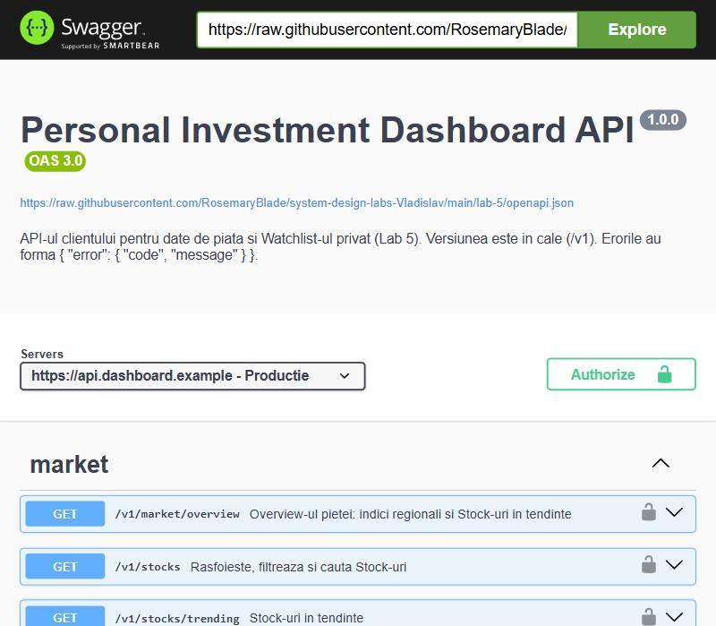
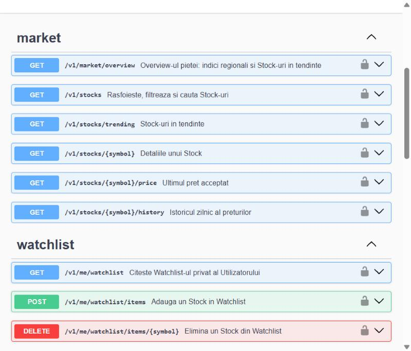
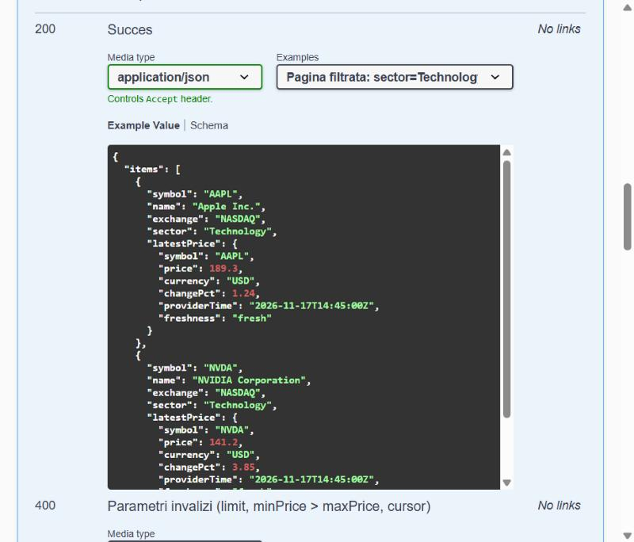
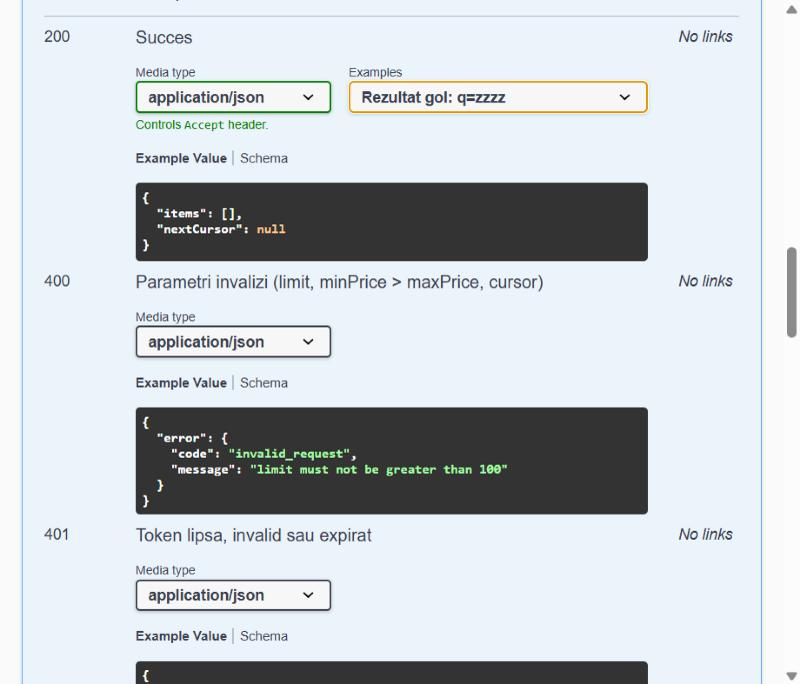

# Verificarea documentului OpenAPI în vizualizator

Documentul generat [`openapi.json`](./openapi.json) a fost deschis direct din acest fork în **Swagger UI**:

`https://petstore.swagger.io/?url=https://raw.githubusercontent.com/RosemaryBlade/system-design-labs-Vladislav/main/lab-5/openapi.json`

L-am verificat și în **Swagger Editor** (`https://editor.swagger.io/?url=...`, aceeași adresă), unde documentul se încarcă fără erori de validare.

## 1. Documentul se încarcă: titlu, versiune, server, autentificare Bearer



## 2. Comparația cu inventarul endpoint-urilor

Toate cele 9 operații din tabelul din [`SOLUTION.md`](./SOLUTION.md#2-endpoint-urile-clientului) apar în document, cu aceleași metode și căi `/v1`. Toate au lacătul (autentificare Bearer).



| Inventar (SOLUTION.md) | În OpenAPI | Coduri de răspuns |
| :--- | :--- | :--- |
| `GET /v1/market/overview` | ✔ | 200, 400, 401, 429, 503 |
| `GET /v1/stocks` | ✔ | 200, 400, 401, 429, 503 |
| `GET /v1/stocks/trending` | ✔ | 200, 400, 401, 429, 503 |
| `GET /v1/stocks/{symbol}` | ✔ | 200, 400, 401, 404, 429, 503 |
| `GET /v1/stocks/{symbol}/price` | ✔ | 200, 400, 401, 404, 429, 503 |
| `GET /v1/stocks/{symbol}/history` | ✔ | 200, 400, 401, 404, 429, 503 |
| `GET /v1/me/watchlist` | ✔ | 200, 401, 429, 503 |
| `POST /v1/me/watchlist/items` | ✔ | 201, 200, 400, 401, 404, 409, 429, 503 |
| `DELETE /v1/me/watchlist/items/{symbol}` | ✔ | 204, 400, 401, 429, 503 |

## 3. Exemple: pagina filtrată

`GET /v1/stocks` → exemplul „Pagina filtrata: sector=Technology&exchange=NASDAQ&limit=2”, cu `nextCursor` pentru pagina următoare.



## 4. Exemple: lista goală și o eroare

Același endpoint, exemplul „Rezultat gol: q=zzzz” (`items: []`, `nextCursor: null`), urmat de răspunsul `400` cu structura unică a erorilor.



## 5. Nepotrivire găsită și corectată

La prima generare, exemplele lipseau din document: `@ApiResponse({ type, content })` suprascria conținutul cu exemple. Am corectat decoratorii în `api/src/controllers.ts` (schema prin `$ref` împreună cu `example`/`examples`) și am regenerat cu `npm run openapi`.

## 6. Verificare la rulare

Serverul pornit local (`npm start`) a răspuns conform documentului:

```text
GET /v1/stocks?sector=Technology&exchange=NASDAQ&limit=2   -> 200 (AAPL, NVDA, nextCursor)
GET /v1/stocks?q=zzzz                                      -> 200 {"items":[],"nextCursor":null}
GET /v1/stocks?limit=500                                   -> 400 invalid_request
GET /v1/me/watchlist (fără token)                          -> 401 unauthorized
GET /v1/stocks/ab$/price                                   -> 400 invalid_symbol
POST /v1/me/watchlist/items {"symbol":"ZZZZ"}              -> 404 stock_not_found
POST /v1/me/watchlist/items {"symbol":"TSLA","owner":"x"}  -> 400 (câmp controlat de server respins)
GET /v1/stocks/AAPL/history?from=2026-01-01&to=2026-11-14  -> 200
DELETE /v1/me/watchlist/items/TSLA                         -> 204
```
